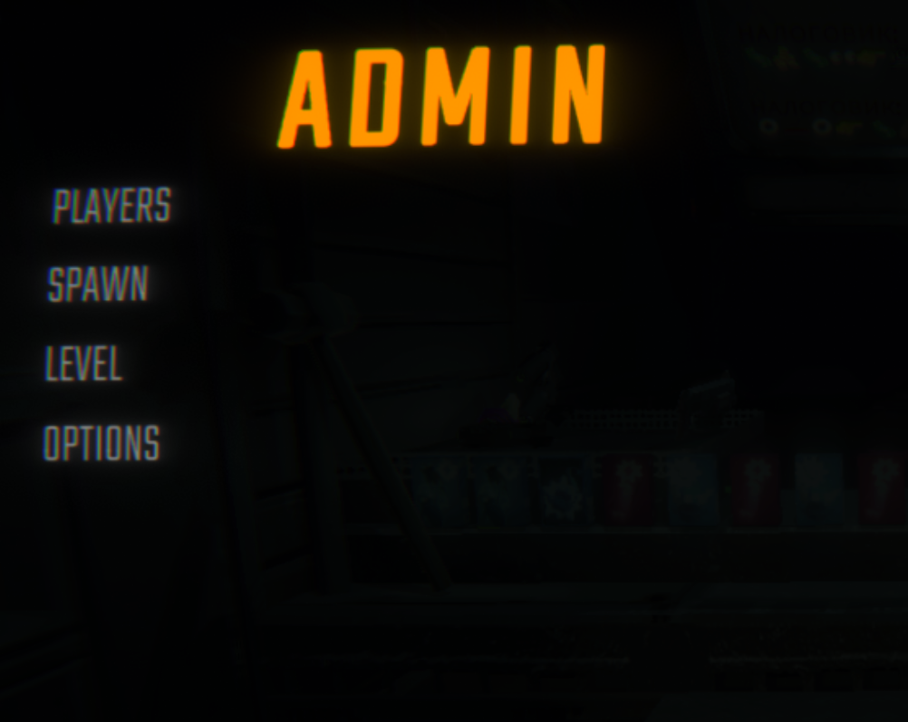
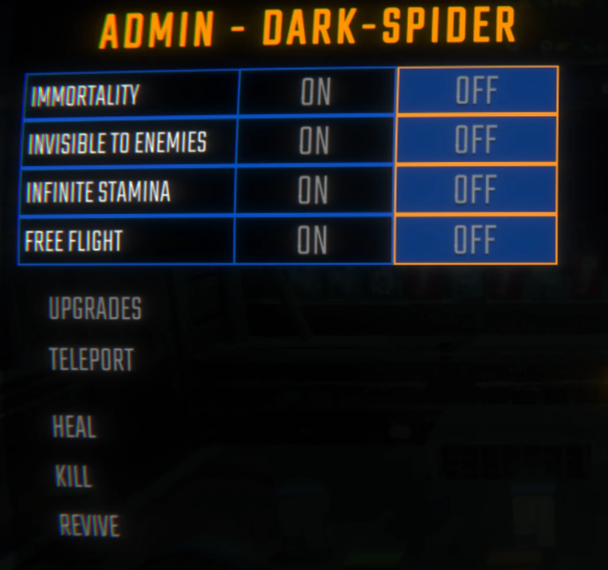
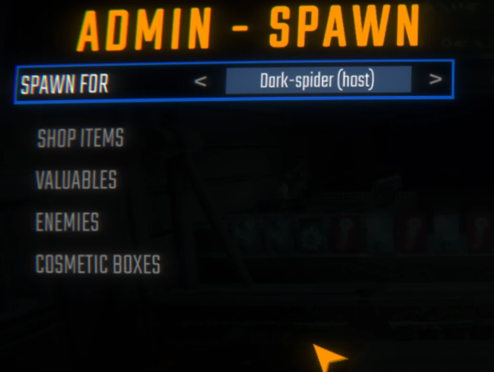
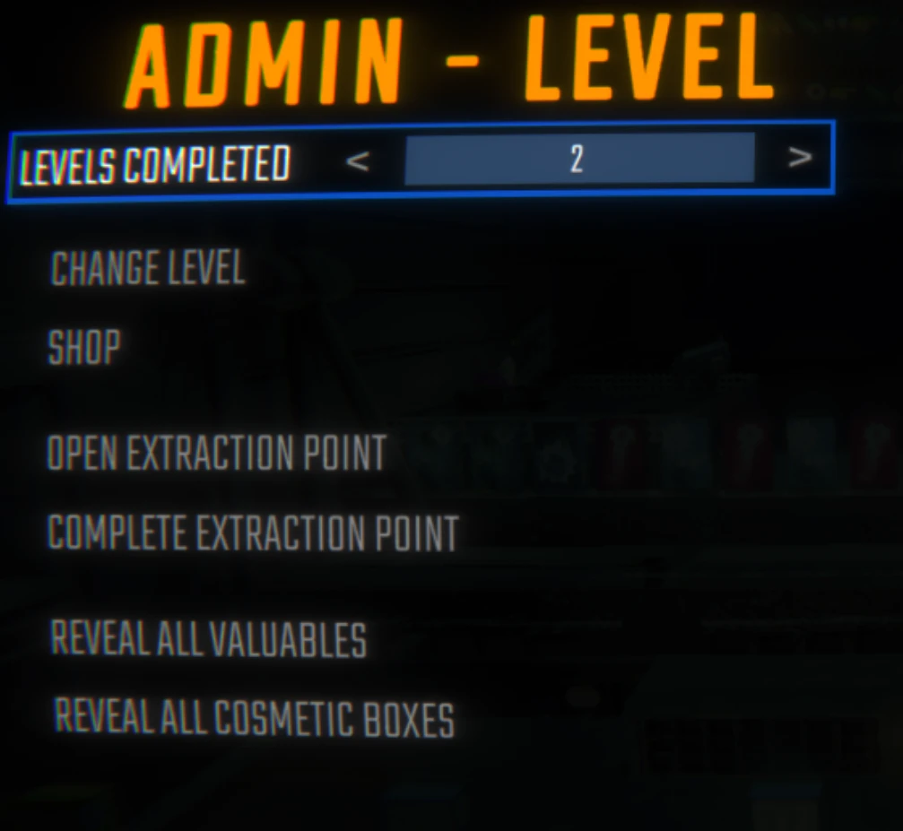
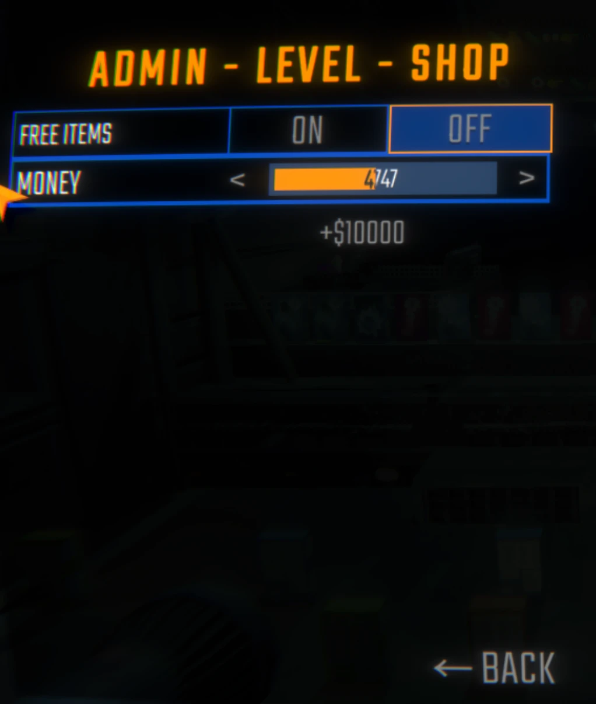

# Admin Menu

Admin Menu gives the host of a R.E.P.O. lobby a proper set of controls instead of a chat command and a lot of hoping.

I made it for the evenings where a run goes sideways for a silly reason: someone is stuck in the ceiling, someone else died on the first corner, and the only way to rescue the night is to restart the whole thing. Now you open a menu, fix the thing, and carry on.

Press **F8** during a run and it opens. Only the host gets it.

## What You Get

- **Everyone in one list.** Pick a player and do things to them. The host is at the top, the dead are marked, and dead players work everywhere the living do.
- **Upgrades on a dial.** Every upgrade the game has, and every one your other mods added, with arrows to set the level. Winding one down takes it away properly, it does not just change a number.
- **Switches per player.** Immortality, invisible to enemies, infinite stamina, and free flight through walls.
- **Free flight.** Fly through the level, stop dead in mid-air when you let go of the keys. Jump and crouch go up and down, sprint goes faster.
- **Teleport, six ways.** Bring a player to you, go to them, send them to anyone else in the lobby, or send them to the truck or the extraction point. A dead player goes as their head, so you can reach someone who fell somewhere unhelpful.
- **Spawn anything.** Shop items, valuables, enemies, cosmetic boxes. You pick who it lands next to.
- **Search.** With a few content mods the lists run past a hundred entries, so there is a search box on top of every one of them.
- **Enemies on a count.** Say how many, click the name, and a countdown appears on screen so you have three seconds to be somewhere else.
- **Modded content sits beside vanilla.** Items, valuables, enemies and levels from other mods show up in the same lists, marked so you can tell.
- **Change the level.** Any level, any shop, the arenas, and anything your mods added. Set how many levels the run has done while you are there.
- **Money and a free shop.** Set the money to whatever you like, or make the shop free. Prices change on the shelves right away, not next shop.
- **Open the extraction point.** Open the next one, or finish the one that is running without meeting the haul.
- **Show everything on the map.** Reveal every valuable and every cosmetic box in the level.
- **Two mischief switches.** Enemies die in one hit, and batteries never run out.
- **Your language.** The menu speaks every language the game does - English, Russian, Ukrainian, German, French, Italian, Spanish (Spain and Latin America), Portuguese (Brazil and Portugal), Polish, Turkish, Swedish, Danish, Finnish, Japanese, Korean, Chinese (Simplified and Traditional), Thai and Arabic - and follows the game: change the language in the game's settings and the menu changes with it. Item, enemy and upgrade names come from the game itself; valuables, which the game only names in English, carry the mod's own translations.

## Showcase

### The menu

Press F8 during a run. Four places to go, and a way back from anywhere.

---

### A player

Switches at the top, then upgrades and teleports, then the things you do once.

---

### Spawning

Pick who it lands next to, then pick what. Shop items, valuables, enemies and cosmetic boxes, all searchable.

---

### The run

Change the level, set how far along the run is, open or finish the extraction point, and put everything worth taking on the map.

---

### The shop

Set the money to whatever you like, or make the whole shop free.

## Multiplayer

Most of it works for the whole lobby and nobody else needs the mod. Upgrades, invisibility, teleport, healing, killing, reviving, spawning, level changes, money, the free shop, the extraction points, one-hit enemies and the batteries all go through the game itself.

Three things are different, because the game works them out on each player's own machine and not on yours: **free flight**, **infinite stamina**, and the part of **immortality** that covers falling. For those, you are not pushing the player around - you are giving them the ability, and their own copy of the mod switches it on.

So a player without the mod installed still gets everything in the first paragraph, including immortality against enemies, traps and falling crates. They just will not fly, and a long drop will still hurt. Nothing breaks and nothing errors; the switch simply does nothing on their side.

For the smoothest run, have everyone on the same version.

## Settings

The config file is created after you launch the game once with the mod installed:

`BepInEx/config/DarkSpider90.AdminMenu.cfg`

You can also change everything in-game through REPOConfig if you have it.

### Menu

**Enable Hotkey** — on by default. Turn it off if you want the key free for another mod.

**Menu Hotkey** — `F8` by default.

**Menu Font Size** — `0` by default, which keeps the size the game uses for its own settings rows. Put a number in if you want the menu bigger or smaller.

**Close Menu On Spawn** — off by default. Turn it on if you would rather the menu got out of the way after you spawn something.

### Upgrades

**Max Upgrade Level** — `25` by default. How far the upgrade arrows go. The game itself has no ceiling; this is only where the menu stops.

### Localization

**Write Language Template** — off by default. Turn it on and the mod writes `Languages/template.lang` next to itself on the next start, with every line of the menu in English. Copy it to a language code (`ru.lang`, `pt-BR.lang`), translate the right-hand side, and the menu picks it up. A file there overrides the built-in translation for that language, so a wording can be fixed without a new release. Anything you leave out falls back to the built-in text.

### Diagnostics

**Verbose Logging** — off by default. Writes what the menu found and what it did to the BepInEx log. Useful in a bug report, noisy the rest of the time.

## Install

Install with a mod manager, or drop `AdminMenu.dll` into your `BepInEx/plugins` folder.

Requires BepInEx, MenuLib and REPOLib.

Without REPOLib the menu still opens and most of it works, but nothing can be spawned and abilities cannot be given to other players.

## ☕ Support Admin Menu

---

> If Admin Menu has saved a run or two of yours, you can support its continued development, compatibility work and multiplayer testing.
>
> ## [❤️ Support DarkSpider on Ko-fi →](https://ko-fi.com/darkspider)
>
> Every coffee helps. Thank you for supporting the mod.

---

## Licence

MIT. See `LICENSE`.
